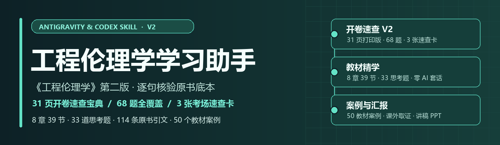

# 工程伦理学学习助手（《工程伦理学》第二版）

一个面向 **《工程伦理学》第二版**（赵莉、姚立根主编，高等教育出版社，2021 年 10 月）的中文学习与考试助手，同时兼容 **Antigravity Skill** 与 **Codex Skill**。支持**考场开卷速查、逐句原书取证、章节复习、原创命题阅卷与课堂案例汇报**。

> **V2 核心原则**：所有开卷答案均经原书印刷第 1–249 页逐句核验并随句标注 `P.XX`，**零无依据 AI 套话、零擅自延伸**，直接服务考场 3 秒定位与规范采分。

  <a href="#一键下载考场资料">一键下载考场资料</a> ·
  <a href="#v2-核心升级对比">V2 升级亮点</a> ·
  <a href="#31-页开卷速查册结构导航">31 页结构导航</a> ·
  <a href="#快速开始">快速开始</a> ·
  <a href="#使用示例">使用示例</a> ·
  <a href="#案例分享与汇报">案例分享</a> ·
  <a href="#教材与版权说明">教材与版权</a> ·
  <a href="#仓库结构与验证">仓库结构</a>

| 教材覆盖 | 章末思考题 | 开卷速查题库 | 考场工具卡 | 原书逐字引文 | 教材案例库 |
|:---:|:---:|:---:|:---:|:---:|:---:|
| **8 章 39 节** | **33 / 33 全覆盖** | **68 题（31 页）** | **3 张速查卡** | **114 条核验** | **50 个案例** |

---

## 一键下载考场资料

2026 年 11 月 25 日 **V2 严格忠实教材版**开卷速查宝典共 **31 页 A4**，零单题孤页，支持双面打印直接带入考场（PDF 含 142 处可点击目录跳转）：

| 资料名称 | 格式与说明 | 适用场景 |
| --- | --- | --- |
| **[A4 打印版 PDF（31 页）](materials/open-book/short-answer-review.pdf)** · **[可编辑 Word](materials/open-book/short-answer-review.docx?raw=true)** | 重点 4 题 + 八章 64 题 + 3 张考场速查卡，核心得分词行内加粗，逐句标 `P.XX` | **直接打印带入开卷考场** |
| **[68 道开卷简答题库（JSONL）](engineering-ethics-study/references/open-book-bank.jsonl)** | 题干、114 条原书引文、241 条分点答案、原书页码与评分标准 | 命令行检索 / 考前自测 |
| **[V2 全面审计与优化清单](materials/open-book-audit-report.md)** | 逐章排查 10 处原书概念偏差、24 处 AI 套话与全部考场改进记录 | 查阅修订依据与避坑点 |
| **[33 道章末思考题参考答案](materials/chapter-review-answers.md)** | 全书八章 33 道原书章末思考题拟答、教材出处与自测评分 | 课后作业与系统复习 |
| **[教材案例与思考题索引](materials/textbook-cases-and-questions.md)** | 50 个教材案例与 33 道思考题的印刷页 / PDF 页速查 | 翻书定位原案例与原题 |
| **[教材底本 Word 校对报告](materials/word-proofreading-report.md)** | 底本页级定位、字符抽检口径与核查说明 | 查证底本准确度口径 |

---

## V2 核心升级对比

对比初版（24 页 / 59 题），本次 V2 全面重构重点解决了**教材忠实度**与**考场实战效率**两大痛点：

| 维度 | 初版（V1） | 升级版（V2 · 当前最新） |
| --- | --- | --- |
| **教材忠实度** | 存在 10 处口径偏差/立场软化及 24 处 AI 流程套话 | **逐页通读 P.1–249 全面清零**；加入套话黑名单自动拦截（命中为 0）；每条要点随句标注 `P.XX` |
| **题量与覆盖** | 59 题（缺 5.1 五原因、8.4 坏工程成因、3.5 责任困境等） | **68 题（`Z1–Z4` + `01–64`）**，**39 节 + 33 道章末思考题 100% 覆盖**，目录显式标出 `思 X.X` |
| **考场速查工具** | 仅 2 行易混文字提示；末页为考场用不上的练习题 | 新增 **3 张整页速查卡**：易混口径总表、原书三大表格精准复刻、29 组高频经典案例一键索引 |
| **原书三大表格** | 未嵌表（表 7-1 漏 3 项维度） | **原书表 1-1（P.7）、表 1-2 完整 16 阶段（P.21）、表 7-1 完整 8 维度（P.201）**一页精准复刻 |
| **版面与分页** | 24 页（第 23 页仅 1 题留白 75%） | **31 页紧凑均衡排版**（正文每页 2–3 题，零孤页）；核心得分词加粗高亮，考场 3 秒定位 |

---

## 31 页开卷速查册结构导航

| 册页范围 | 模块名称 | 核心内容 |
| :---: | --- | --- |
| **第 1–2 页** | **双页考场速查目录** | 3 张速查卡 + 重点 4 题 + 八章 64 题，列明 `题号 / 关键词 / 教材节 / 章末思考题 / 册页`（71 项动态页码 + 142 处 PDF 跳转） |
| **第 3 页** | **速查卡一：高频易混口径对照总表** | 表 A（六组原则/规范/评估标准严防答串）· 表 B（全书六组三阶段/三层次演变总对照）· 表 C（八组易混成对概念辨析） |
| **第 4 页** | **速查卡二：教材三大核心原表复刻** | 原书 **表 1-1**（科学/工程/艺术五维对比，P.7）· **表 1-2**（全周期 16 阶段与工程决策，P.21）· **表 7-1**（末端治理 vs 污染预防八维对比，P.201） |
| **第 5–6 页** | **重点四题（`Z1–Z4`）** | 研究内容范围作用 · 五项基本原则 · 工程师职业道德内涵本质要求 · 结合专业履行伦理责任（全部锚定教材条款，附专业套写示范） |
| **第 7–30 页** | **八章精审简答库（`01–64`）** | 覆盖全书 8 章 39 节与 33 道思考题，含 114 条逐字校验原书引文与 241 条加粗得分要点 |
| **第 31 页** | **速查卡三：29 组经典教材案例索引** | 按章速查白沙洲大桥、青藏铁路、三鹿、黄禹锡、李昌钰、陈晓兰、水立方北移、长江水污染、天津港、棱镜门、三门峡、切尔诺贝利等权威案例与原书页码 |

展开查看：八章 64 题详细分布与新增高频考点

- **第一章 概论（`01–08`，P.7–9）**：工程六大维度与三阶段、表 1-1 三种思维、工程师职业关系与声望、现代工程三特征与表 1-2、道德三层次与四种精神气质、实践伦理五特征、三类研究方法与困境求解、工程师与管理者分工及科技人才“专博通/实创理/责学和”。
- **第二章 研究综述（`09–12`，P.10–11）**：道德新定义与改革开放三阶段三范式、义利统一观/公平正义/经济评估三原则、三元论反附庸论与狭义/广义转向、四项道德规范与复杂性/特殊性（肖平、刘平斋）。
- **第三章 工程师的责任（`13–22`，P.12–15）**：工程观五维度与新时代五理念、米切姆三阶段与技术专家领导评析、信念伦理/伦克六趋势/齐默里两特点、职业道德三层次六阶段与“不服从组织”三方式、设计/符合性质量与三大里程碑案、主动 vs 被动责任及恐惧启迪/有罪假定、知情同意两条件两合理性、伦理关联主义与哈里斯九种超文化规范、对雇主与顾客直接责任、责任困境三原因与米切姆两条摆脱途径。
- **第四章 利益相关者与社会责任（`23–28`，P.15–17）**：契约三阶段/不完全性四原因/四原则、布莱尔观点与企业多边契约、工程社会性与决策民主化、工程共同体与工人弱势三方面、工程师与雇主关系四种模式（代理→信托）、伦理责任三次转向与事前“预凶”。
- **第五章 诚信与道德问题（`29–37`，P.17–20）**：讲求人道主义五大原因与三大障碍、人道主义五项要求、诚信定位与四项信息义务、工程研究五准则、制造建造四准则、试验检测四准则（含人道主义“不以国家规定为限”）、商业活动四准则（含禁商业贿赂/禁侵占财物）、公共事务两类差异化准则、商业与公共事务异同对比。
- **第六章 利益相关方的博弈（`38–45`，P.20–23）**：决策四组博弈/环评三同时/文物法五规定/纳什均衡、施工四组博弈与监理职责、工程师与经理冲突三原因与杰卡尔经理伦理观、思考道德问题三大依据（含法律局限性）、社会责任与揭发（ASCE 第四条）、雇主忠诚四义务/忠诚与批评/跳槽、推己度人/普适性/目的论与道义论利弊/道德妥协、教材章末案例《长江水体污染事件》五对策评析范式。
- **第七章 工程与生态责任（`46–52`，P.24–26）**：工程生态观演变与技术主义反思、和谐发展工程观与四点要求、国际规范（ASCE/IEEE/ASME/AIChE/WFEO）与可持续发展、生态伦理三特征/环保三要求/动物解放 vs 动物权利、绿色工程五术语（含产品五特征/材料三内涵）、表 7-1 八维对比、可持续消费/话语意识 vs 实践意识/四种社会消费支撑系统。
- **第八章 工程伦理的应用（`53–64`，P.26–30）**：危险 vs 风险与工程风险特征成因、“能够”不等于“应当”与技术/社会双评估、基因工程三作用/转基因三风险/反对克隆人、基因决定论批驳、基因技术四原则、数字化生存意义与人脑电脑关系、隐私安全（含黑客）/信息崇拜四批判/网瘾/谣言、三观三德与制度建设两大原则（尊重他人/保障自我）、土木三大特性与三种公正（含同代公正三举措）、五项评价标准与“坏的”工程三大成因、三种责任意识与工程良心三大作用及局限、跨章综合案例分析四步路径。

---

## 快速开始

### 1. 作为 Skill 安装（支持 Antigravity 与 Codex）

将仓库中的 [engineering-ethics-study](engineering-ethics-study/) 文件夹整体复制到对应全局 Skill 目录即可：

- **Antigravity**：`~/.gemini/config/skills/engineering-ethics-study/`
- **Codex**：`~/.codex/skills/engineering-ethics-study/`

对话调用示例：

~~~text
用 engineering-ethics-study 对比主动性责任和被动性责任，
严格按《工程伦理学》第二版原书口径给简答得分点并标注原书页码。
~~~

### 2. 命令行直接检索（仅需 Python 3 标准库）

从仓库根目录运行：

~~~bash
# 查指定小节知识点与原书页码
python engineering-ethics-study/scripts/lookup.py --section 3.5

# 查教材经典案例（支持编号或关键词）
python engineering-ethics-study/scripts/lookup.py --case "三鹿"

# 查 68 道 V2 开卷简答题库（前缀 EE-OPEN-）
python engineering-ethics-study/scripts/lookup.py --bank engineering-ethics-study/references/open-book-bank.jsonl --item EE-OPEN-Z2
python engineering-ethics-study/scripts/lookup.py --bank engineering-ethics-study/references/open-book-bank.jsonl --item EE-OPEN-63

# 查 74 道分节与章末练习题库
python engineering-ethics-study/scripts/lookup.py --review 1.5
python engineering-ethics-study/scripts/lookup.py --questions 6.5
python engineering-ethics-study/scripts/lookup.py --item EE-ORIG-06-05
~~~

---

## 使用示例

| 常见需求 | 怎么问 / 怎么查 | 获得的结果 |
| --- | --- | --- |
| **区分易混口径** | 五项基本原则、四项道德规范、人道主义五项要求有什么区别？ | 精准给出 P.41–42、P.69、P.136 各自原书枚举与适用问法，绝不串味 |
| **核对教材原立场** | 教材如何评价“工程良心”的作用与局限？ | 给出 P.247–248 三大作用与原句“工程良心是有用的，但不是万能的” |
| **双视角案例对比** | 三鹿毒奶粉事件和三鹿庭审记录分别怎么分析？ | 第 5 章人道主义与国标滞后视角（P.131/148）+ 第 6 章经理/技术冲突视角（P.167） |
| **自测与规范阅卷** | 出两道第 6 章的题，先给题面，交卷后再按原书评分 | 题面、可核对的教材依据页与分项扣分标准 |
| **课堂案例分享** | 用我提供的调查报告做 7 分钟工程伦理课堂分享 | 事实时间线、教材伦理框架论证、口语讲稿与逐页图文 PPT 提纲 |

---

## 案例分享与汇报

支持教材内 50 个正式案例与课外真实工程事件的课堂分享：先核对调查报告与时间线、复原关键决策与备选方案，再以教材伦理框架完成论证，输出口语讲稿、逐页图文大纲与交付自检。详见 [案例分享指南](engineering-ethics-study/references/case-sharing.md)。

---

## 教材与版权说明

- **参考教材**：赵莉、姚立根主编《工程伦理学》（第二版），高等教育出版社，2021 年 10 月，ISBN `978-7-04-056942-1`。[出版社图书页面](https://www.hep.com.cn/book/show/d0cc3797-e263-4819-8933-4267a2eb5a19)
- **数据范围**：本仓库仅公开结构化知识卡、自编复习/开卷速查资料、题库与检索工具，**不包含整本教材扫描 PDF 或整书全文文本**。教材短句均标注原书印刷页码，权利人如需反馈请通过 [Issues](https://github.com/PengyuLaider/engineering-ethics-study/issues) 联系，核实后将及时处理。

使用个人持有的原书排版版 Word 或页索引做全文查证

~~~bash
python engineering-ethics-study/scripts/lookup.py --word "工程伦理学（第二版）-原书排版版.docx" --printed 93-95
python engineering-ethics-study/scripts/lookup.py --index "教材页索引.jsonl" "普适性" "道义论"
~~~

`--word` 适用于带 `PDF_001`–`PDF_267` 页级书签的原书排版版 Word（例如原书第 95 页对应书签 `PDF_107`）。

---

## 仓库结构与验证

| 路径 | 用途 |
| --- | --- |
| [engineering-ethics-study/SKILL.md](engineering-ethics-study/SKILL.md) | 教材复习、开卷速查与案例分享统一入口 |
| [engineering-ethics-study/references/course-map.md](engineering-ethics-study/references/course-map.md) | 全书 8 章 39 节知识地图与依据页 |
| [engineering-ethics-study/references/open-book-workflow.md](engineering-ethics-study/references/open-book-workflow.md) | 逐句紧扣教材、零 AI 套话与考场排版校验规范 |
| [engineering-ethics-study/references/open-book-bank.jsonl](engineering-ethics-study/references/open-book-bank.jsonl) | 68 道逐句核验原书的开卷简答题库 |
| [engineering-ethics-study/references/question-bank.jsonl](engineering-ethics-study/references/question-bank.jsonl) | 74 道教材思考题与分节原创练习题库 |
| [engineering-ethics-study/references/knowledge.jsonl](engineering-ethics-study/references/knowledge.jsonl) | 39 节知识卡 + 12 个跨章主题 + 50 个教材案例卡 |
| [engineering-ethics-study/scripts/lookup.py](engineering-ethics-study/scripts/lookup.py) | 零依赖命令行检索脚本 |
| [materials/](materials/) | 31 页开卷速查 PDF/Word、V2 审计清单、章末思考题答案、案例索引与校对报告 |
| [tests/smoke_test.py](tests/smoke_test.py) | 覆盖章节、跨章主题、案例、练习题与 V2 开卷题库的冒烟测试 |

运行冒烟测试：

~~~bash
python tests/smoke_test.py
~~~
